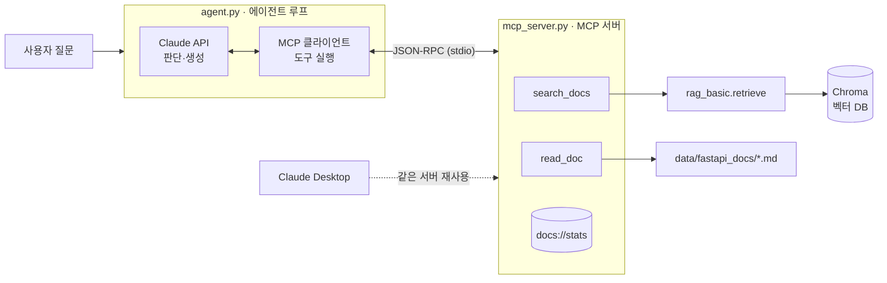

# FastAPI Docs Agent — RAG · MCP · Agent 직접 구현하기

FastAPI 공식 문서를 근거로 질문에 답하는 AI 에이전트입니다.
**RAG(검색 증강 생성) → MCP(Model Context Protocol) 서버 → 직접 구현한 에이전트 루프**를 단계별로 쌓아 올리며,
세 기술이 어떻게 맞물려 하나의 워크플로우가 되는지 학습하고 기록한 프로젝트입니다.

> LangChain 같은 프레임워크 없이 각 계층을 직접 구현해, 내부 동작을 코드 수준에서 설명할 수 있는 것을 목표로 했습니다.

<!-- 데모 GIF: agent.py 실행 화면 (turn별 도구 호출 로그가 보이도록) -->
<!--  -->

---

## 아키텍처



| 계층 | 파일 | 역할 |
|---|---|---|
| **RAG** | `rag_basic.py` | 문서 청킹 → 임베딩 → Chroma 저장 → 유사도 검색 |
| **MCP** | `mcp_server.py` | RAG 검색을 표준 도구(Tool)와 리소스(Resource)로 노출 |
| **Agent** | `agent.py` | Claude가 도구 사용을 스스로 판단하는 ReAct 루프 (생각 → 행동 → 관찰 → 반복) |

핵심 설계 원칙: **각 계층은 아래 계층을 수정하지 않고 감싸기만 합니다.**
2단계에서 만든 MCP 서버는 Claude Desktop과 직접 만든 에이전트(3단계) 양쪽에서 코드 수정 없이 그대로 재사용됩니다.

---

## 기술 스택

| 구분 | 선택 | 이유 |
|---|---|---|
| 언어 | Python 3.12 | MCP·Chroma·Anthropic SDK 모두 Python을 1순위로 지원 |
| 패키지 관리 | uv | 가상환경·설치·실행을 한 번에, MCP 공식 문서 기준 도구 |
| 벡터 DB | Chroma (로컬) | 별도 서버 없이 파일로 저장, 기본 임베딩 모델 내장 |
| 임베딩 | all-MiniLM-L6-v2 (Chroma 기본) | API 키 없이 로컬에서 임베딩 |
| LLM | Claude API (Anthropic SDK) | Tool Use 지원 |
| 프로토콜 | MCP Python SDK 2.x (`MCPServer`) | 공식 SDK |

---

## 프로젝트 구조

```
rag-portfolio/
├── rag_basic.py       # 1단계: RAG 파이프라인 (index / search / ask)
├── mcp_server.py      # 2단계: MCP 서버 (search_docs, read_doc, docs://stats)
├── agent.py           # 3단계: 에이전트 루프 + MCP 클라이언트
├── data/fastapi_docs/ # FastAPI 영문 문서 (git 제외)
├── chroma_db/         # 벡터 DB 저장소 (git 제외)
├── .env               # ANTHROPIC_API_KEY (git 제외)
└── pyproject.toml
```

---

## 실행 방법

### 1. 환경 구성

```bash
# uv 설치 후
uv sync

# 학습 데이터: FastAPI 영문 문서
git clone --depth 1 https://github.com/fastapi/fastapi.git tmp_fastapi
cp -r tmp_fastapi/docs/en/docs data/fastapi_docs   # Windows: Copy-Item -Recurse
rm -rf tmp_fastapi
```

프로젝트 최상위에 `.env` 파일을 **UTF-8**로 만들고 API 키를 넣습니다.

```
ANTHROPIC_API_KEY=sk-ant-...
```

### 2. 1단계 — 기본 RAG

```bash
uv run rag_basic.py index ./data/fastapi_docs        # 인덱싱 (청크 2,947개)
uv run rag_basic.py search "background tasks"        # 검색 결과만 확인 (LLM 호출 없음)
uv run rag_basic.py ask "How do I run background tasks after returning a response?"
```

### 3. 2단계 — MCP 서버

```bash
uv run mcp dev mcp_server.py    # MCP Inspector로 도구 테스트 (Node.js 필요)
```

Claude Desktop 연결 (`설정 → 개발자 → 설정 편집`, 기존 내용은 유지하고 `mcpServers`만 추가):

```json
{
  "mcpServers": {
    "fastapi-docs": {
      "command": "C:\\Users\\<사용자>\\.local\\bin\\uv.exe",
      "args": ["--directory", "E:\\Workplace\\rag-portfolio", "run", "mcp_server.py"]
    }
  }
}
```

### 4. 3단계 — 직접 구현한 에이전트

```bash
uv run agent.py "How do I run background tasks after returning a response?"
uv run agent.py      # 대화 모드
```

---

## 단계별 구현 내용

### 1단계: 기본 RAG (`rag_basic.py`)

```
로드 → 청킹 → 임베딩·저장 → 검색(Top-k) → 프롬프트 구성 → Claude 답변
```

- **청킹 전략:** 마크다운 헤더(`#`~`###`) 단위로 의미를 먼저 나누고, 1,000자를 넘는 섹션만 150자 겹침(overlap)을 두고 분할. 코드 블록 안의 `# 주석`은 헤더로 인식하지 않도록 처리
- **메타데이터:** 각 청크에 출처 파일과 섹션 제목을 저장해 답변에 근거 번호(`[1]`, `[2]`)로 인용
- **결정적 청크 ID:** `파일 경로 + 섹션 순번 + 청크 순번`의 해시를 ID로 사용 → 재인덱싱 시 중복 저장 없이 덮어쓰기(upsert)
- **`search` 명령 분리:** RAG 품질 문제는 대부분 검색 단계에서 생기므로, LLM 호출 없이 검색 결과와 거리(distance)만 확인하는 명령을 따로 둠

### 2단계: RAG를 MCP 서버로 (`mcp_server.py`)

| 노출 항목 | 종류 | 설명 |
|---|---|---|
| `search_docs(query, top_k)` | Tool | 벡터 검색. LLM이 스스로 호출 |
| `read_doc(source)` | Tool | 검색된 문서의 전체 원문. 청크만으로 부족할 때 사용 |
| `docs://stats` | Resource | 인덱스 상태. 사용자가 골라서 첨부하는 읽기 전용 데이터 |

- **Tool 스키마 자동 생성:** 함수 이름 = 도구 이름, 타입 힌트 = 입력 스키마, docstring = 도구 설명. LLM은 docstring만 보고 도구 사용 여부를 판단하므로, 언제 쓰는지·입력 형식·결과 해석법까지 구체적으로 작성
- **서버는 검색(R)만, 생성(G)은 클라이언트의 LLM이:** 1단계와 달리 서버는 LLM을 호출하지 않음
- **입력 검증:** `read_doc`은 문서 폴더 안의 `.md` 파일만 허용 (`../.env` 같은 경로 조작 차단)
- **절대경로:** Claude Desktop은 서버를 프로젝트 폴더가 아닌 위치에서 실행하므로, DB·`.env` 경로를 파일 위치 기준 절대경로로 지정

### 3단계: 직접 구현한 에이전트 루프 (`agent.py`)

```python
while turn < MAX_TURNS:
    resp = claude(messages, tools)                  # 생각
    if resp.stop_reason != "tool_use":
        return 최종 답변
    for 도구 요청 in resp:
        result = mcp_session.call_tool(...)         # 행동
        tool_results.append(tool_result(id, result)) # 관찰
    messages += [assistant 응답, tool_results]      # 반복
```

- **MCP 도구 → Claude Tool 형식 변환:** 이름·설명·JSON 스키마 구조가 거의 같아 몇 줄로 변환
- **`tool_use_id`로 요청-결과 짝 맞추기:** 한 turn에 여러 도구를 동시에 요청할 수 있음
- **대화 기록 = 단기 기억:** LLM은 상태가 없으므로 매 turn마다 전체 `messages`를 다시 전송
- **안전장치:** 최대 반복 횟수(`MAX_TURNS = 6`), 도구 실행 실패도 `is_error`로 Claude에게 전달해 스스로 대처하게 함
- **turn별 로그:** `stop_reason`, 도구 호출 인자, 결과 요약을 출력해 판단 과정을 관찰

---

## 실행 결과 비교

질문: *"How do I run background tasks after returning a response?"*

| | 1단계 (고정 파이프라인) | 3단계 (에이전트) |
|---|---|---|
| 검색 여부 결정 | 코드가 결정 (항상 1회) | Claude가 결정 |
| 도구 호출 | `retrieve` 1회 | `search_docs` → `read_doc` (스스로 원문 추가 조회) |
| LLM 호출 | 1회 | 3회 (turn 1~3) |
| 답변 범위 | 기본 사용법 | 기본 사용법 + dependency 연동, `BackgroundTask`와의 차이, Celery 비교, `yield` dependency 주의사항 |

```
[turn 1] stop_reason = tool_use
[tool_use] search_docs({"query": "run background tasks after returning a response", "top_k": 5})
[turn 2] stop_reason = tool_use
[tool_use] read_doc({"source": "data\\fastapi_docs\\tutorial\\background-tasks.md"})
[turn 3] stop_reason = end_turn
```

---

## 트러블슈팅 기록

| 문제 | 원인 | 해결 |
|---|---|---|
| `UnicodeDecodeError: byte 0xff` (`import chromadb`에서 발생) | PowerShell `echo > .env`가 파일을 UTF-16으로 저장. Chroma가 import 시점에 `.env`를 읽다 실패 | VS Code에서 UTF-8로 다시 저장. `.gitignore`도 같은 문제로 동작하지 않던 것을 함께 수정 |
| `DuplicateIDError` (인덱싱 800개에서 중단) | 청크 ID에 섹션 **제목**을 사용 → 한 문서에 같은 제목(`## Recap` 등)이 반복되면 ID 충돌 | 섹션 **순번**으로 ID 생성. 문서 갱신 시 덮어쓰기 vs 중복 저장을 결정하는 ID 설계 문제임을 확인 |
| `No module named 'mcp.server.fastmcp'` | MCP Python SDK 2.x에서 `FastMCP`가 `MCPServer`로 이름 변경 | 2.x import를 우선 시도하고 1.x로 대체하는 호환 코드 작성 |
| Claude Desktop 설정이 롤백됨 | 앱 실행 중에 설정 파일의 기존 내용(`preferences`)을 지우고 저장 → 앱이 메모리 상태로 덮어씀 | 앱 완전 종료 후 기존 내용을 유지한 채 `mcpServers`만 추가 |
| Claude Desktop `spawn ... ENOENT` / `uvx` 오류 | 실제와 다른 사용자 폴더 경로, `uvx`는 스크립트 실행 불가 | `where.exe uv`로 확인한 실제 경로와 `uv run` 사용. 로그는 `%APPDATA%\Claude\logs\mcp-server-*.log` |

---

## 발견한 한계와 개선 계획

- [ ] **예제 코드 누락:** FastAPI 문서는 예제를 `{* ../../docs_src/... *}` 참조로 불러옴 → 인덱스에 실제 코드가 없어 에이전트가 근거 없이 코드를 구성. 인덱싱 시 참조를 실제 코드로 치환 예정
- [ ] **노이즈 문서:** 사용법 질문에 `release-notes.md`가 상위에 검색됨 → 메타데이터 필터링 또는 리랭킹 적용
- [ ] **섹션 제목 정리:** `{ #recap }` 같은 앵커 표기 제거
- [ ] **관련도 기준선:** 무관한 질문의 distance 분포를 측정해 "근거 없음" 판단 기준 설정
- [ ] **서버 시작 시간:** Claude Desktop 첫 연결 시 초기화에 약 14초 → 무거운 import 지연 로딩(lazy loading)
- [ ] **평가 세트:** 질문-정답 세트로 검색 정확도와 답변 품질을 개선 전후 비교

---

## 로드맵

- [x] **1단계** 기본 RAG
- [x] **2단계** RAG를 MCP 서버로 감싸고 Claude Desktop 연결
- [x] **3단계** 프레임워크 없이 에이전트 루프 직접 구현
- [ ] **4단계** 외부 MCP 서버(GitHub) 추가 — 문서에 답이 없으면 이슈 검색, 이슈 초안 작성 후 **사람 승인(Human-in-the-loop)** 뒤 등록
- [ ] **5단계** 고도화 — 하이브리드 검색(BM25 + 벡터), 리랭킹, 다국어 임베딩
- [ ] **6단계** 평가와 문서화
