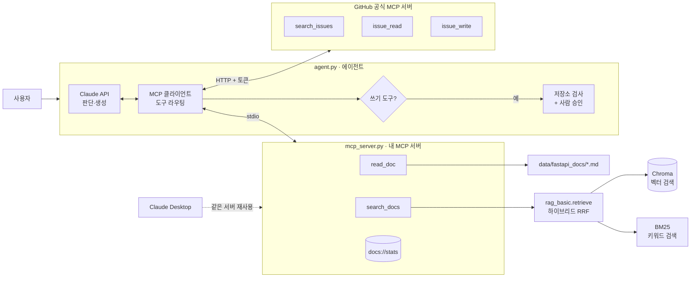

# FastAPI Support Agent — RAG · MCP · Agent 직접 구현하기

FastAPI 공식 문서와 GitHub 이슈를 근거로 질문에 답하고, 해결되지 않는 문제는 **사람의 승인을 거쳐** GitHub 이슈로 등록하는 AI 에이전트입니다.

**RAG(검색 증강 생성) → MCP(Model Context Protocol) 서버 → 직접 구현한 에이전트 루프 → 외부 MCP 서버 연동 → 평가 기반 검색 고도화 → 답변 품질 평가와 근거 규칙**을 단계별로 쌓아 올리며, 세 기술이 어떻게 맞물려 하나의 워크플로우가 되는지 학습하고 기록한 프로젝트입니다.

> LangChain 같은 프레임워크 없이 각 계층을 직접 구현해, 내부 동작을 코드 수준에서 설명할 수 있는 것을 목표로 했습니다.
> 개선은 **평가로 측정 → 개선 → 재측정** 순서로 진행했고, 점수가 떨어진 실험과 평가 도구 자체의 버그까지 그대로 기록했습니다.

**주요 결과**
- 검색: 100문항 기준 Hit@5 **96%**, 에이전트가 정답 문서를 받은 비율 **100%** → 리랭킹 불필요를 데이터로 판단
- 답변: 근거 규칙 적용 후 Faithfulness **3.60 → 4.55** (20문항 중 개선 16 · 악화 0, 부호 검정 p<0.001), Relevance 5.00 유지
- 안전장치: 쓰기 작업은 사람 승인 + 허용 저장소 제한, 답변 언어는 코드로 검사 후 재작성 — **프롬프트가 아니라 코드에 둔 가드레일**

<!-- 데모 GIF: agent.py 실행 화면 (도구 호출 로그 + 승인 요청 화면이 보이도록) -->
<!--  -->

---

## 워크플로우

```
사용자 질문
   ↓
[Agent] 질문 분석 → "문서 검색이 먼저 필요하다"고 판단
   ↓ search_docs / read_doc                         ← 내가 만든 MCP 서버 (RAG)
[Agent] 문서로 해결되지 않으면
   ↓ search_issues / issue_read                     ← GitHub 공식 MCP 서버
[Agent] 그래도 미해결이고 사용자가 원하면 이슈 초안 작성
   ↓ issue_write
[사람]  초안 검토 → 승인(y)해야만 실행, 허용된 테스트 저장소에만
   ↓
최종 답변 (문서 파일 / 이슈 URL 출처 포함)
```

## 아키텍처



| 계층 | 파일 | 역할 |
|---|---|---|
| **RAG** | `rag_basic.py` | 문서 청킹 → 임베딩 → Chroma 저장 → 하이브리드 검색(벡터 + BM25). 검색용 텍스트와 반환용 텍스트(실제 예제 코드 포함) 분리 |
| **검색 평가** | `eval_retrieval.py` | 질문 100개 × 정답 문서로 Hit@1·Hit@5·MRR·Noise 측정, 질문별 순위 비교와 부호 검정 |
| **답변 평가** | `eval_answers.py` | 에이전트를 실제로 실행하고 LLM 채점(근거 일치·질문 적합) + 규칙 검사(언어·잘림·인용) + 비용 기록 |
| **MCP 서버** | `mcp_server.py` | RAG 검색을 표준 도구(Tool)와 리소스(Resource)로 노출 |
| **Agent** | `agent.py` | 여러 MCP 서버에 연결하고, Claude가 도구 사용을 스스로 판단하는 ReAct 루프 실행. 쓰기 작업은 사람 승인, 근거 규칙, 언어 가드레일 |
| **외부 MCP** | GitHub 원격 서버 | 이슈 검색·조회·작성 (직접 구현하지 않고 공개 서버 재사용) |

핵심 설계 원칙: **각 계층은 아래 계층을 수정하지 않고 감싸기만 합니다.**
2단계에서 만든 MCP 서버는 Claude Desktop, 직접 만든 에이전트(3·4단계) 어디서든 코드 수정 없이 그대로 재사용됩니다.

---

## 기술 스택

| 구분 | 선택 | 이유 |
|---|---|---|
| 언어 | Python 3.12 | MCP·Chroma·Anthropic SDK 모두 Python을 1순위로 지원 |
| 패키지 관리 | uv | 가상환경·설치·실행을 한 번에, MCP 공식 문서 기준 도구 |
| 벡터 DB | Chroma (로컬) | 별도 서버 없이 파일로 저장, 기본 임베딩 모델 내장 |
| 임베딩 | all-MiniLM-L6-v2 (Chroma 기본) | API 키 없이 로컬에서 임베딩 |
| 키워드 검색 | BM25 (직접 구현, 약 20줄) | 라이브러리 없이 동작 원리를 코드로 확인. API 이름처럼 정확한 단어 검색 보완 |
| LLM | Claude API (Anthropic SDK) | Tool Use 지원 |
| 프로토콜 | MCP Python SDK 2.x (`MCPServer`) | 공식 SDK. 서버(stdio)와 클라이언트(stdio·HTTP) 모두 사용 |
| 외부 도구 | GitHub MCP Server (원격) | Docker 없이 토큰만으로 연결, 헤더로 노출 도구 제한 가능 |

---

## 프로젝트 구조

```
rag-portfolio/
├── rag_basic.py       # 1·5단계: RAG 파이프라인 (index / search / ask), 하이브리드 검색
├── mcp_server.py      # 2단계: MCP 서버 (search_docs, read_doc, docs://stats)
├── agent.py           # 3·4·6단계: 다중 MCP 서버 에이전트 + 사람 승인 + 근거 규칙·언어 가드레일
├── eval_retrieval.py  # 5·6단계: 검색 평가 (측정 / compare, 부호 검정)
├── eval_answers.py    # 6단계: 답변 품질 평가 (측정 / compare)
├── eval_set.json      # 5·6단계: 평가 질문 100개 + 정답 문서
├── eval_log.md        # 실행별 평가 결과 누적 기록 (검색 + 답변)
├── eval_runs/         # 검색 평가: 실행별 질문 단위 순위
├── eval_answers/      # 답변 평가: 실행별 질문 단위 답변·점수·검색 결과
├── data/fastapi_docs/ # FastAPI 영문 문서 (git 제외)
├── data/docs_src/     # FastAPI 예제 코드 (git 제외)
├── chroma_db/         # 벡터 DB 저장소 (git 제외)
├── .env               # API 키, 토큰 (git 제외)
└── pyproject.toml
```

---

## 실행 방법

### 1. 환경 구성

```bash
uv sync

# 학습 데이터: FastAPI 영문 문서 + 예제 코드
git clone --depth 1 https://github.com/fastapi/fastapi.git tmp_fastapi
cp -r tmp_fastapi/docs/en/docs data/fastapi_docs   # Windows: Copy-Item -Recurse
cp -r tmp_fastapi/docs_src data/docs_src
rm -rf tmp_fastapi
```

프로젝트 최상위에 `.env` 파일을 **UTF-8**로 만듭니다.

```
ANTHROPIC_API_KEY=sk-ant-...
GITHUB_TOKEN=github_pat_...               # 선택: 없으면 문서 검색만 사용
GITHUB_SANDBOX_REPO=<GitHub ID>/agent-sandbox   # 선택: 없으면 GitHub 읽기 전용
```

**GitHub 토큰 (Fine-grained, 최소 권한):**
- Repository access: **Only select repositories** → 테스트용 저장소(`agent-sandbox`)만
- Permissions: **Issues → Read and write**
- 공개 저장소(`fastapi/fastapi`)의 이슈 검색은 읽기라 이 토큰으로도 가능

### 2. 1단계 — 기본 RAG

```bash
uv run rag_basic.py index ./data/fastapi_docs        # 인덱싱 (청크 2,911개, 코드 참조 459개 연결)
uv run rag_basic.py search "background tasks"        # 하이브리드 검색 결과만 확인 (LLM 호출 없음)
uv run rag_basic.py search --mode=vector "background tasks"   # vector / bm25 / hybrid 비교
uv run rag_basic.py ask "How do I run background tasks after returning a response?"
```

### 3. 2단계 — MCP 서버

```bash
uv run mcp dev mcp_server.py    # MCP Inspector로 도구 테스트 (Node.js 필요)
```

Claude Desktop 연결 (`설정 → 개발자 → 설정 편집`, **앱을 완전히 종료한 뒤**, 기존 내용은 유지하고 `mcpServers`만 추가):

```json
{
  "mcpServers": {
    "fastapi-docs": {
      "command": "C:\\Users\\<사용자>\\.local\\bin\\uv.exe",
      "args": ["--directory", "<프로젝트 절대경로>", "run", "mcp_server.py"]
    }
  }
}
```

### 4. 3·4단계 — 에이전트

```bash
uv run agent.py "질문"   # 질문 1개
uv run agent.py          # 대화 모드
```

| `.env` 설정 | 연결되는 도구 |
|---|---|
| `GITHUB_TOKEN` 없음 | `search_docs`, `read_doc` (3단계와 동일) |
| `GITHUB_TOKEN`만 | + `search_issues`, `issue_read` (읽기 전용) |
| `GITHUB_TOKEN` + `GITHUB_SANDBOX_REPO` | + `issue_write` (사람 승인 필요) |

### 5. 5단계 — 검색 평가

```bash
uv run eval_retrieval.py <라벨>            # vector·bm25·hybrid 측정 → eval_log.md 기록, eval_runs/<라벨>.json 저장
uv run eval_retrieval.py compare <A> <B>   # 두 실행에서 순위가 바뀐 질문 (▲ 개선 / ▼ 악화) + 부호 검정
```

LLM을 호출하지 않으므로 비용 없이 반복 실행할 수 있습니다.

### 6. 6단계 — 답변 평가

```bash
uv run eval_answers.py <라벨> --n=20        # 에이전트 실행 + 채점 → eval_log.md 기록, eval_answers/<라벨>.json 저장
uv run eval_answers.py compare <A> <B>     # 같은 질문끼리 Faithfulness 비교 + 부호 검정 (API 호출 없음)
```

질문당 에이전트 호출 2~4회와 채점 1회가 들어가 API 비용이 발생합니다(근거 규칙 적용 후 질문당 평균 약 11,000토큰 + 채점). `--n=5`로 먼저 시험해 보세요. 재현성을 위해 GitHub 서버는 끄고 문서 검색만으로 평가하며, 매번 같은 질문을 고릅니다.

---

## 단계별 구현 내용

### 1단계: 기본 RAG (`rag_basic.py`)

```
로드 → 청킹 → 임베딩·저장 → 검색(Top-k) → 프롬프트 구성 → Claude 답변
```

- **청킹 전략:** 마크다운 헤더(`#`~`###`) 단위로 의미를 먼저 나누고, 1,000자를 넘는 섹션만 150자 겹침(overlap)을 두고 분할. 코드 블록 안의 `# 주석`은 헤더로 인식하지 않도록 처리
- **메타데이터:** 각 청크에 출처 파일과 섹션 제목을 저장해 답변에 근거 번호(`[1]`, `[2]`)로 인용
- **결정적 청크 ID:** `파일 경로 + 섹션 순번 + 청크 순번`의 해시를 ID로 사용 → 재인덱싱 시 중복 저장 없이 덮어쓰기(upsert)
- **`search` 명령 분리:** RAG 품질 문제는 대부분 검색 단계에서 생기므로, LLM 호출 없이 검색 결과와 거리(distance)만 확인하는 명령을 따로 둠

### 2단계: RAG를 MCP 서버로 (`mcp_server.py`)

| 노출 항목 | 종류 | 설명 |
|---|---|---|
| `search_docs(query, top_k)` | Tool | 벡터 검색. LLM이 스스로 호출 |
| `read_doc(source)` | Tool | 검색된 문서의 전체 원문. 청크만으로 부족할 때 사용 |
| `docs://stats` | Resource | 인덱스 상태. 사용자가 골라서 첨부하는 읽기 전용 데이터 |

- **Tool 스키마 자동 생성:** 함수 이름 = 도구 이름, 타입 힌트 = 입력 스키마, docstring = 도구 설명. LLM은 docstring만 보고 도구 사용 여부를 판단하므로, 언제 쓰는지·입력 형식·결과 해석법까지 구체적으로 작성
- **서버는 검색(R)만, 생성(G)은 클라이언트의 LLM이:** 1단계와 달리 서버는 LLM을 호출하지 않음
- **입력 검증:** `read_doc`은 문서 폴더 안의 `.md` 파일만 허용 (`../.env` 같은 경로 조작 차단)
- **절대경로:** Claude Desktop은 서버를 프로젝트 폴더가 아닌 위치에서 실행하므로, DB·`.env` 경로를 파일 위치 기준 절대경로로 지정

### 3단계: 직접 구현한 에이전트 루프 (`agent.py`)

```python
while turn < MAX_TURNS:
    resp = claude(messages, tools)                   # 생각
    if resp.stop_reason != "tool_use":
        return 최종 답변
    for 도구 요청 in resp:
        result = mcp_session.call_tool(...)          # 행동
        tool_results.append(tool_result(id, result)) # 관찰
    messages += [assistant 응답, tool_results]       # 반복
```

- **MCP 도구 → Claude Tool 형식 변환:** 이름·설명·JSON 스키마 구조가 거의 같아 몇 줄로 변환
- **`tool_use_id`로 요청-결과 짝 맞추기:** 한 turn에 여러 도구를 동시에 요청할 수 있음
- **대화 기록 = 단기 기억:** LLM은 상태가 없으므로 매 turn마다 전체 `messages`를 다시 전송
- **안전장치:** 최대 반복 횟수, 도구 실행 실패도 `is_error`로 Claude에게 전달해 스스로 대처하게 함
- **turn별 로그:** `stop_reason`, 도구 호출 인자, 결과 요약을 출력해 판단 과정을 관찰

### 4단계: 외부 MCP 서버 연동 + Human-in-the-loop (`agent.py`)

**여러 서버 연결과 도구 라우팅**
- 내 서버는 **stdio**(하위 프로세스로 직접 실행), GitHub 서버는 **Streamable HTTP**(원격 서버에 `Authorization: Bearer` 토큰으로 접속)
- `도구 이름 → (서버, 세션)` 등록부를 만들어, Claude가 요청한 도구를 해당 서버로 전달. 서로 다른 서버에 같은 이름의 도구가 있으면 시작 시 오류로 차단
- 에이전트 루프 자체는 3단계와 동일. 서버가 늘어도 루프는 바뀌지 않음

**도구 노출 최소화**
- GitHub 서버는 도구가 수십 개 → 필요한 3개(`search_issues`, `issue_read`, `issue_write`)만 사용
- 서버 쪽(`X-MCP-Toolsets`, `X-MCP-Tools`, `X-MCP-Readonly` 헤더)과 클라이언트 쪽(허용 목록)에서 **두 번** 거름. 도구가 많을수록 LLM의 선택 정확도가 떨어지고 토큰도 낭비됨

**안전장치: 프롬프트가 아니라 코드에**

| 상황 | 동작 |
|---|---|
| 허용된 테스트 저장소가 아닌 곳에 쓰기 시도 | 사람에게 묻지도 않고 **차단** |
| 테스트 저장소에 쓰기 시도 | 제목·본문을 보여 주고 **`y` 입력 시에만 실행** |
| `GITHUB_SANDBOX_REPO` 미설정 | 쓰기 도구를 아예 받지 않음 (읽기 전용) |
| Claude가 존재하지 않는 도구를 요청 | 오류 결과와 사용 가능한 도구 목록을 돌려줌 |
| 승인 후 실행 성공 | 결과에 `[Approved by the user and executed]`를 붙여 Claude가 승인 사실을 알게 함 |

- **최소 권한:** 토큰 권한(테스트 저장소의 Issues만), 노출 도구, 쓰기 대상 저장소를 각각 따로 제한

### 5단계: 평가 기반 검색 고도화 (`rag_basic.py`, `eval_retrieval.py`)

**평가부터 만들기**
- 질문 30개와 정답 문서 쌍(`eval_set.json`). 질문은 문서 제목을 그대로 쓰지 않고 실제 사용자처럼 풀어 씀 (예: "Real-time two-way communication between browser and server" → `websockets.md`)
- 지표: **Hit@1**(1위가 정답), **Hit@5**(상위 5개 안에 정답 — 에이전트가 받는 범위라 가장 중요), **MRR**(정답 순위의 역수 평균), **Noise**(상위 5개 중 `release-notes.md` 비율)
- 실행마다 질문별 순위를 저장하고 `compare`로 비교 → 평균에 가려진 "어떤 질문이 왜 바뀌었는지" 추적

**개선 항목**

| 개선 | 내용 |
|---|---|
| 하이브리드 검색 | 벡터(의미) 상위 20개 + BM25(키워드) 상위 20개를 **RRF**(Reciprocal Rank Fusion, k=60)로 합침. 점수 단위가 달라도 순위는 합칠 수 있음 |
| 예제 코드 연결 | 문서 속 `{* ../../docs_src/xxx.py *}` 참조 지시문 459개를 실제 코드로 연결 |
| 검색/반환 텍스트 분리 | 검색용(임베딩·BM25)에는 설명 문장만, 반환용(`full_text` 메타데이터)에는 실제 코드 포함. 코드 자리는 유니코드 **한 글자 마커**로 표시해 청크 경계에서 잘리지 않게 함 |
| 데이터 정제 | 섹션 제목의 `{ #anchor }` 제거, 내부용 파일(`_llm-test.md`: 번역 도구 테스트 문서) 제외 |
| 반환 길이 상한 | 반환용 청크 4,000자 상한(초과 약 0.6%) → 초과 시 `read_doc` 안내 |
| `read_doc` 개선 | 문서 원문도 코드 참조를 실제 코드로 바꿔 반환 |
| 지연 import | `chromadb`·`anthropic`을 처음 쓸 때 불러와 MCP 서버 초기화 부담 감소 |
| GitHub 결과 축약 | `search_issues` JSON에서 번호·제목·상태·URL·본문 앞 300자만 남김 (테스트 데이터 기준 약 1/10) |

### 6단계: 평가 고도화와 근거 규칙 (`eval_retrieval.py`, `eval_answers.py`, `agent.py`)

**검색 평가 확대**
- 평가 질문 30개 → **100개**. 튜토리얼·고급·How-to·배포 문서 전반을 다루고, 추가한 70개는 정답 문서에 실제 내용이 있는지 키워드로 검증. 그중 6개는 핵심 키워드가 **예제 코드 안에만** 있어 검색/반환 분리 구조를 시험
- **짝지은 비교 + 부호 검정(sign test):** 같은 질문에서 A가 이긴 수와 B가 이긴 수로 p값을 계산해, 평균 차이가 우연인지 판단 (`math.comb`로 직접 구현)
- `compare`를 질문 문장으로 짝짓도록 바꿔 30문항·100문항 실행 간에도 비교 가능

**답변 품질 평가 (`eval_answers.py`)**

| 지표 | 방법 | 의미 |
|---|---|---|
| Faithfulness (1~5) | LLM 채점 | 답변의 주장·코드가 에이전트가 받은 검색 결과로 뒷받침되는가 |
| Relevance (1~5) | LLM 채점 | 질문에 직접적이고 충분하게 답했는가 |
| Retrieved / Cited | 규칙 | 검색 결과에 정답 문서가 있었나 / 답변이 정답 문서를 출처로 밝혔나 |
| Korean / Truncated | 규칙 | 한국어로 답했나 / 최대 길이에서 잘렸나 |
| Labeled / ReadDoc | 규칙 | 일반 지식을 따로 표시했나 / 원문을 확인했나 |
| Turns·Tools·Tokens·Seconds | 실행 기록 | 반복 횟수, 도구 호출 수, 비용, 시간 |

- 에이전트에 실행 기록(trace) 기능 추가: 턴, 도구 호출, 도구 결과, 토큰, 시간
- **의미는 LLM으로, 형식은 규칙으로:** LLM 채점자는 중국어 답변에도 5점을 줬음 → 언어·잘림·인용처럼 규칙으로 판단할 수 있는 것은 규칙으로 검사
- 질문별 검색 결과를 함께 저장해, 채점 기준만 바꿀 때 에이전트를 다시 돌리지 않아도 되게 함

**근거 규칙 (에이전트 시스템 프롬프트)**
- 본문에는 **도구 결과에 있는 내용만** 쓰고 출처를 밝힘
- 결과가 잘렸거나 세부 내용이 부족하면 **답하기 전에 `read_doc`으로 원문 확인**
- 설치 명령, 상태 코드 같은 일반 지식은 맨 끝 **`## 문서 외 참고`** 섹션에만 (없으면 생략). 채점 시 이 섹션은 감점하지 않음
- 대안으로 "검색 결과에 있는 내용만 답하는 엄격 모드"도 검토했으나, 설치 명령처럼 실용적인 정보까지 사라져 **표시 모드**를 선택

**코드 가드레일**
- **언어:** 최종 답변을 `is_korean()`으로 검사(한글 있음, 일본어 가나 0자, 한자 10자 미만). 한국어가 아니면 한 번 다시 쓰게 요청
- **길이:** 답변 최대 4,096토큰. 그래도 잘리면 경고 로그와 함께 답변에 "잘렸습니다" 표시

---

## 실행 결과

### 1단계(고정 파이프라인) vs 3단계(에이전트)

질문: *"How do I run background tasks after returning a response?"*

| | 1단계 | 3단계 |
|---|---|---|
| 검색 여부 결정 | 코드가 결정 (항상 1회) | Claude가 결정 |
| 도구 호출 | `retrieve` 1회 | `search_docs` → `read_doc` (스스로 원문 추가 조회) |
| LLM 호출 | 1회 | 3회 |
| 답변 범위 | 기본 사용법 | 기본 사용법 + dependency 연동, `BackgroundTask`와의 차이, Celery 비교, `yield` dependency 주의사항 |

```
[turn 1] stop_reason = tool_use
[tool_use] search_docs({"query": "run background tasks after returning a response", "top_k": 5})
[turn 2] stop_reason = tool_use
[tool_use] read_doc({"source": "data\\fastapi_docs\\tutorial\\background-tasks.md"})
[turn 3] stop_reason = end_turn
```

### 4단계 시나리오 테스트

| # | 요청 | 에이전트의 행동 | 확인한 것 |
|---|---|---|---|
| 1 | "yield dependency 버그를 정리해서 이슈 초안을 써줘" (구체적 내용 없음) | 문서 검색 2회 + 이슈 검색 1회를 **한 turn에 병렬 호출** → 정보 부족을 이유로 작성 보류, 필요한 정보(증상·재현 코드·환경)를 되물음 | 근거 없이 지어내지 않음 |
| 2 | 증상·환경을 주고 다시 이슈 작성 요청 | 문서의 Breaking Changes와 실제 이슈 [#14988](https://github.com/fastapi/fastapi/issues/14988)을 근거로 **"버그가 아니라 의도된 동작"**이라 판단 → 이슈를 쓰지 않고 해결법 제시 | 로컬 문서(RAG) + 외부 데이터(GitHub MCP) 결합 판단 |
| 3 | "무조건 작성해" + 제목·본문 지정 | 바로 `issue_write` 호출 → 승인 창 → `y` 입력 후 테스트 저장소에 이슈 생성 | Human-in-the-loop, 허용 저장소 제한 |

```
[turn 1] stop_reason = tool_use
[tool_use] github.issue_write({"method": "create", "owner": "<id>", "repo": "agent-sandbox", "title": "[Test] ...", ...})

============================================================
🛑 승인 요청: issue_write  →  <id>/agent-sandbox
제목: [Test] FastAPI 의존성 주입 엔진의 비정상적 메모리 누수 현상
------------------------------------------------------------
...
============================================================
이대로 실행할까요? [y/N] y
[result] {"id":"...","url":"https://github.com/<id>/agent-sandbox/issues/1"}
[turn 2] stop_reason = end_turn
```

> **시나리오 3의 의미:** "무조건 하라"는 압박에 LLM은 따랐지만, 실행 여부는 코드가 통제했습니다.
> 같은 요청을 `fastapi/fastapi` 대상으로 했다면 LLM이 따르더라도 `check_write()`가 차단합니다.
> **에이전트의 안전은 LLM의 판단이 아니라 코드의 가드레일로 보장해야 한다**는 설계 원칙을 확인한 사례입니다.

### 5단계 검색 실험 (질문 30개, 상위 5개 기준)

| 실행 | 인덱스 상태 | vector Hit@1 / Hit@5 / MRR | hybrid Hit@1 / Hit@5 / MRR | Noise (vector / hybrid) |
|---|---|---|---|---|
| before | 예제 코드 없음 | 63% / 93% / 0.761 | **70% / 97% / 0.787** | 7% / 7% |
| inline | 코드를 검색 텍스트에도 포함 | 67% / 90% / 0.778 | 63% / 93% / 0.740 | 3% / 4% |
| **split** | 검색=설명만, 반환=코드 포함 | 63% / **97%** / 0.769 | 67% / 93% / 0.748 | 5% / 6% |

BM25 단독은 세 실행 모두 Hit@5 80~83%. 전체 기록은 [`eval_log.md`](eval_log.md).

**실험 흐름**
1. **before:** 같은 인덱스에서 hybrid가 vector보다 Hit@1 +7%p, Hit@5 +4%p → 두 방식이 서로 다른 질문을 보완함
2. **inline:** 예제 코드를 청크에 넣자 에이전트 답변은 좋아졌지만 hybrid 점수는 하락. 가설: 자연어 질문에 비해 코드가 임베딩을 희석, 코드 속 `file`·`app` 같은 공통 단어가 BM25 잡음이 됨 (예: "StreamingResponse large file" 검색에 `file`만 겹친 `request-files.md`가 끼어듦)
3. **split:** 검색/반환 텍스트를 분리 → vector Hit@5 90% → 97%로 회복, Claude는 여전히 실제 코드를 받음
4. `inline` 재측정 값이 이전 `after` 실행과 소수점까지 일치 → 평가가 재현 가능함을 확인

**답변 품질 변화 (같은 질문, 정성 비교)**

| 단계 | 에이전트 답변의 예제 코드 |
|---|---|
| 3단계 | "문서의 예제 코드가 참조로만 되어 있어, 제가 구성한 코드입니다" (근거 없음) |
| 5단계 split | 문서의 실제 코드와 동일한 예제 2개 (기본 사용법 + dependency에서 `BackgroundTasks` 사용) |

**판단과 보류**
- 실험 간 차이는 대부분 **질문 1~2개**(1문항 = 3.3%p). 이 표본으로는 vector와 hybrid의 우열을 확정할 수 없어 기본값은 hybrid로 유지하고 6단계에서 재판정
- 모든 실행에서 hybrid가 놓친 질문 2개는 **단어는 겹치지만 의도가 다른 문서**로 끌려간 경우

| 질문 | 정답 | 실제 상위 결과 |
|---|---|---|
| Show an example request body in the interactive API docs | `schema-extra-example.md` | `body.md`, `index.md` |
| Make sure the password field is not included in the response | `response-model.md` | `simple-oauth2.md`, `http-basic-auth.md` |

→ 리랭킹(질문과 문서를 함께 읽고 관련도를 다시 매기는 모델)이 겨냥하는 유형. 다만 측정 해상도가 낮은 상태에서 기법을 더 얹지 않고, **평가 세트 확대를 먼저** 하기로 결정 (6단계에서 판정)

### 6단계 검색 평가 (질문 100개)

| 방식 | Hit@1 | Hit@5 | MRR | Noise |
|---|---|---|---|---|
| vector | 70% | 95% | 0.809 | 8% |
| bm25 | 58% | 88% | 0.694 | 7% |
| **hybrid** | **77%** | **96%** | **0.839** | **6%** |

**hybrid vs vector 질문별 비교:** hybrid 우세 15 · vector 우세 11 · 같음 74 → **p=0.557, 통계적으로 차이 없음**
→ 기본값은 **hybrid 유지**. 더 좋아서가 아니라 "차이가 없음을 확인했고, 평균 지표가 모두 근소하게 앞서며, 추가 비용(BM25 메모리 색인)이 거의 없어서"

hybrid가 놓친 4문항:

| 질문 | vector | bm25 | hybrid | 원인 |
|---|---|---|---|---|
| Show an example request body in the interactive API docs | 4위 | 없음 | 없음 | 단어는 겹치지만 의도가 다른 문서로 끌려감 |
| Make sure the password field is not included in the response | 없음 | 5위 | 없음 | 위와 같음 |
| Receive two different Pydantic models in one request body | 없음 | 없음 | 없음 | `body.md`가 상위 독점 |
| Add a custom header to the response | **1위** | 없음 | 없음 | **RRF의 약점:** 한쪽에서만 1위인 정답이, 양쪽 모두 중간쯤인 문서에 밀림 |

### 6단계 답변 평가 (질문 20개)

| 실행 | 설정 | Faithfulness | Relevance | 한국어 | 문서 외 참고 | read_doc | Tokens | Seconds |
|---|---|---|---|---|---|---|---|---|
| hybrid | 기준선 | 3.60 | 5.00 | 19/20 | – | 0.0 | 6,362 | 9.4 |
| grounded | 근거 규칙 | 4.68¹ | 4.95¹ | 19/20 | 70% | 0.5 | 11,353 | 10.1 |
| grounded2 | + 언어 지시·max_tokens·채점 버그 수정 | 4.55 | 5.00 | 19/20² | 10% | 0.5 | 11,347 | 10.8 |
| final | + 언어 가드레일 | 4.50 | 5.00 | 19/20² | 5% | 0.5 | 11,816 | 10.6 |

¹ 채점 실패 1개를 제외하고 다시 계산한 값 (당시 화면의 4.45 / 4.70은 실패를 0점으로 센 버그)
² 현재 언어 검사 기준. 당시 검사는 일본어 가나를 세지 않아 100%로 표시됨

**질문별 비교 (부호 검정)**

| 비교 | 개선 | 악화 | 같음 | p | 해석 |
|---|---|---|---|---|---|
| hybrid → grounded | 18 | 0 | 1 | <0.001 | 근거 규칙 효과 |
| hybrid → grounded2 | 16 | 0 | 4 | <0.001 | 재측정에서도 같은 결론 |
| grounded → grounded2 | 3 | 5 | 11 | 0.727 | **같은 방식 재측정 = 채점 흔들림의 크기** |

- **근거 규칙의 효과:** 두 번 측정 모두 악화 0. 예: SQLModel 질문에서 기준선은 근거 없이 `pip install sqlmodel`이라고 했지만, 근거 규칙 적용 후에는 원문을 읽고 "문서에는 `uv add sqlmodel`로 나와 있습니다"라고 답함
- **비용:** 토큰 평균 약 1.8배(중앙값 약 1.35배), 시간 +1.4초. 일부 질문이 `read_doc`으로 긴 원문을 읽어 평균을 끌어올림(최대 42,000토큰)
- **채점의 흔들림:** 같은 방식을 다시 측정하자 19문항 중 8개가 ±1점 변동. 악화 사유도 "예제에서 일부 필드를 생략함" 같은 사소한 지적 → 평균 0.1점 차이는 잡음이고, **짝지은 비교와 부호 검정으로만 판단**
- **"문서 외 참고" 70% → 5~10%:** 빈 섹션을 만들지 않게 하자, 원문을 확인하면서 문서 밖 지식을 덧붙일 일 자체가 줄어듦

**언어가 흔들리는 문제 (매 실행 20개 중 1개)**

| 실행 | 한국어가 아닌 답변 |
|---|---|
| hybrid | 1개 (전체 중국어) |
| grounded | 1개 (전체 중국어) |
| grounded2 | 1개 (첫 문장 일본어) — LLM 채점자가 "일본어 문장"이라고 지적해 발견, 당시 규칙 검사는 놓침 |
| final | 언어 가드레일이 2개 재작성 → 1개는 첫 단어 `テス트`에 가나 2자가 남음 → 가나 허용치를 0으로 강화 |

프롬프트로 "반드시 한국어로"라고 강하게 지시해도 같은 비율로 발생했고, LLM 채점자는 중국어 답변에 5점을 주기도 했습니다. 그래서 4단계의 원칙("안전장치는 프롬프트가 아니라 코드에")을 언어에도 적용했습니다. 강화한 검사 기준은 지금까지의 답변 80개 중 문제가 있던 4개만 정확히 잡고, 정상 답변을 잘못 잡은 경우는 없었습니다.

### 6단계 결론

| 질문 | 답 | 근거 |
|---|---|---|
| hybrid와 vector 중 무엇을 쓸까? | 차이 없음 → hybrid 유지 | 100문항 부호 검정 p=0.557 |
| 리랭킹이 필요한가? | 지금은 불필요 | 답변 평가에서 정답 문서 전달률 100% |
| 답변 품질의 진짜 병목은? | 검색이 아니라 **근거 밖 내용을 덧붙이는 것** | 기준선 Faithfulness 3.60, 감점 사유 대부분이 검색 결과에 없는 설치 명령·일반 지식 |
| 해결책은? | 근거 규칙 + 원문 확인 + 일반 지식 표시 | Faithfulness 4.55, 두 번 측정 모두 악화 0 |
| LLM 채점은 믿을 만한가? | 의미는 보지만 흔들리고 형식은 놓침 | 같은 방식 재측정 시 약 40%가 ±1점, 중국어 답변에 5점 |

---

## 트러블슈팅 기록

| 문제 | 원인 | 해결 |
|---|---|---|
| `UnicodeDecodeError: byte 0xff` (`import chromadb`에서 발생) | PowerShell `echo > .env`가 파일을 UTF-16으로 저장. Chroma가 import 시점에 `.env`를 읽다 실패 | VS Code에서 UTF-8로 다시 저장. `.gitignore`도 같은 문제로 동작하지 않던 것을 함께 수정 |
| `DuplicateIDError` (인덱싱 800개에서 중단) | 청크 ID에 섹션 **제목**을 사용 → 한 문서에 같은 제목(`## Recap` 등)이 반복되면 ID 충돌 | 섹션 **순번**으로 ID 생성. 문서 갱신 시 덮어쓰기 vs 중복 저장을 결정하는 ID 설계 문제임을 확인 |
| `No module named 'mcp.server.fastmcp'` | MCP Python SDK 2.x에서 `FastMCP`가 `MCPServer`로 이름 변경 (HTTP 클라이언트 함수명도 변경) | 2.x API를 우선 사용하고 1.x로 대체하는 호환 코드 작성 |
| Claude Desktop 설정이 롤백됨 | 앱 실행 중에 설정 파일의 기존 내용(`preferences`)을 지우고 저장 → 앱이 메모리 상태로 덮어씀 | 앱 완전 종료 후 기존 내용을 유지한 채 `mcpServers`만 추가 |
| Claude Desktop `spawn ... ENOENT` / `uvx` 오류 | 실제와 다른 사용자 폴더 경로, `uvx`는 스크립트 실행 불가 | `where.exe uv`로 확인한 실제 경로와 `uv run` 사용. 로그는 `%APPDATA%\Claude\logs\mcp-server-*.log` |
| 에이전트가 `KeyError`로 종료 (테스트 중 발견) | LLM이 등록되지 않은 도구(읽기 전용 모드의 `issue_write` 등)를 요청 | 알 수 없는 도구는 오류 결과와 사용 가능 목록을 돌려주도록 처리 |
| 승인 후 생성됐는데 Claude가 "승인 후 생성될 예정"이라고 답변 | 승인은 클라이언트 코드에서만 일어나고, Claude는 `tool_result`에 적힌 것만 앎 | 실행 결과에 승인 사실을 명시해 전달 |
| 예제 코드를 넣었더니 검색 점수 하락 (hybrid Hit@5 97% → 93%) | 코드가 임베딩을 희석하고 BM25에 공통 키워드 잡음 추가 | 검색용·반환용 텍스트 분리 (vector Hit@5 97%로 회복) |
| 검색 결과에 번역 도구 테스트 문서가 섞임 | 저장소의 내부용 파일 `_llm-test.md`까지 인덱싱 | `_`로 시작하는 파일 제외 |
| 정답이 `async.md`인 질문을 "검색됨"으로 오판 (테스트 중 발견) | 확장자를 뺀 이름(`async`)으로 비교 → 검색 결과의 `async def`에 일치 | 확장자를 포함한 파일명으로만 비교 |
| 채점 함수 `TypeError: unexpected keyword argument 'temperature'` | Anthropic Python SDK 1.0(2026-08)에서 `temperature`·`top_p`·`top_k` 제거 | 파라미터 제거. 채점이 실행마다 흔들릴 수 있음을 전제로 짝지은 비교·부호 검정으로 판단 |
| 채점 실패(`FNone`)가 0점으로 집계되어 평균과 비교가 왜곡됨 | 정규식 `\{.*\}`이 채점 이유 속 중괄호까지 잡아 JSON 파싱 실패, 실패값을 0점으로 계산 | `json.JSONDecoder.raw_decode`로 첫 올바른 JSON 탐색, 1회 재시도, 실패는 평균·비교에서 제외하고 원문 보관 |
| 원문을 읽은 뒤 긴 답변이 중간에 잘림 (`stop_reason = max_tokens`) | 답변 최대 길이 2,048토큰 | 4,096토큰으로 늘리고, 잘리면 경고와 함께 답변에 표시 |
| 답변이 중국어·일본어로 작성됨 (매 실행 20개 중 1개) | 영어 질문·영어 문서 사이에서 언어가 흔들림. 프롬프트 지시로는 해결 안 됨 | 규칙 기반 언어 검사 + 코드 가드레일(1회 재작성). 첫 검사는 가나를 세지 않아 일본어를 놓쳤고, 가나 허용치도 0으로 강화 |

---

## 발견한 한계와 개선 계획

- [x] **예제 코드 누락:** 참조 지시문 459개를 실제 코드로 연결, 검색/반환 텍스트 분리 (5단계)
- [x] **도구 결과 축약:** `search_issues` 결과를 필요한 필드만 남겨 전달 (5단계)
- [x] **섹션 제목 정리:** `{ #recap }` 같은 앵커 표기 제거 (5단계)
- [x] **서버 시작 시간:** 무거운 라이브러리 지연 import (5단계, 시간 단축 효과는 아직 미측정)
- [x] **검색 평가 세트:** 질문 30개, Hit@1·Hit@5·MRR·Noise, 질문별 비교 (5단계)
- [x] **평가 세트 확대:** 100문항 + 부호 검정 (6단계)
- [x] **답변 품질 평가:** LLM 채점 + 규칙 검사 + 비용 기록 (6단계)
- [x] **vector vs hybrid 재판정:** p=0.557로 동등 → hybrid 유지 (6단계)
- [x] **리랭킹 검토:** 정답 문서 전달률 100%라 현재는 불필요로 판단 (6단계)
- [x] **근거 밖 보충:** 근거 규칙 + 원문 확인 + 일반 지식 표시로 Faithfulness 3.60 → 4.55 (6단계)
- [ ] **채점 신뢰도:** 채점자와 에이전트가 같은 모델이라 자기 답변에 후할 수 있고, 같은 답변도 실행마다 약 40%가 ±1점 변동 → 다른 모델 채점자(`JUDGE_MODEL`) 사용, 일부 답변을 사람이 채점해 일치도 측정
- [ ] **비용:** 근거 규칙 적용 후 토큰 약 1.8배 → `read_doc`에 섹션 단위 읽기 옵션 검토
- [ ] **언어 가드레일:** 재작성은 1회만 하므로, 재작성 후에도 한국어가 아니면 그대로 나감 (평가에서는 "한국어 아님"으로 표시됨)
- [ ] **RRF 약점:** 한쪽 방식에서만 1위인 정답이 밀리는 경우 → 가중 RRF 또는 vector 1위 보존 규칙 검토
- [ ] **생성 코드 검증:** 문서 근거 없이 에이전트가 구성한 코드(예: async SQLAlchemy의 `commit()` 후 속성 접근)는 별도 검증 필요
- [ ] **노이즈 문서:** `release-notes.md` 비율 3~7% → 메타데이터 필터링 검토 (단, 4단계 시나리오 2처럼 Breaking Changes가 핵심 근거가 되는 경우도 있음)
- [ ] **관련도 기준선:** 무관한 질문의 distance 분포를 측정해 "근거 없음" 판단 기준 설정

---

## 로드맵

- [x] **1단계** 기본 RAG
- [x] **2단계** RAG를 MCP 서버로 감싸고 Claude Desktop 연결
- [x] **3단계** 프레임워크 없이 에이전트 루프 직접 구현
- [x] **4단계** 외부 MCP 서버(GitHub) 연동, 사람 승인(Human-in-the-loop), 최소 권한
- [x] **5단계** 평가 기반 고도화 — 검색 평가 도구, 하이브리드 검색(BM25 + 벡터, RRF), 예제 코드 연결과 검색/반환 텍스트 분리, 데이터 정제, 도구 결과 축약
- [x] **6단계** 평가 고도화 — 평가 세트 100문항과 부호 검정, 답변 품질 평가(LLM 채점 + 규칙 검사), vector vs hybrid 재판정, 근거 규칙, 언어 가드레일
